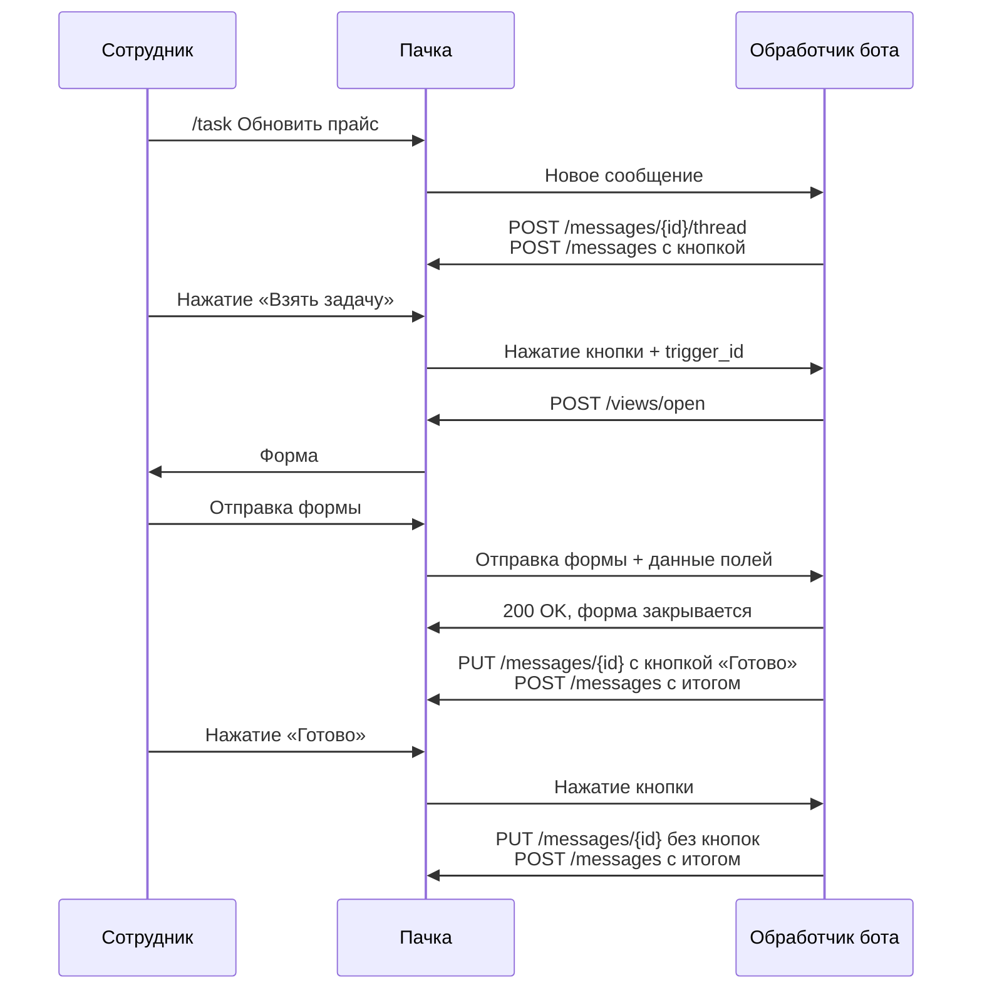

> Расположение: Боты
> Краткое содержание: Пошаговое руководство с кодом на TypeScript и Python: бот принимает команду в чате, отвечает тредом с кнопкой, по нажатию открывает форму, принимает её отправку, пишет итог в чат и меняет кнопки в сообщении
> Это Markdown-версия конкретной страницы. Для контекста за её пределами (правила API, полный перечень методов, авторизация) ОБЯЗАТЕЛЬНО открой [llms.txt](https://dev.pachca.com/llms.txt) перед ответом — это сэкономит токены и предотвратит неполный ответ.


# Интерактивный бот

Здесь собран бот, который ведёт задачи прямо в чате. Сотрудник пишет в канале `/task Обновить прайс`, и бот отвечает тредом с кнопкой «Взять задачу». По нажатию бот открывает форму со сроком и комментарием, а после отправки пишет итог в тред и меняет кнопку на «Готово». Нажатие «Готово» убирает кнопки и закрывает задачу.

Бот — один обработчик исходящего вебхука, код на TypeScript (Express) и Python (Flask). Как бот получает сообщение и отвечает на него без кнопок и форм, показано в разделе [Первый бот](/guides/bots/first-bot).

**Как работает бот**




## Что настроить


  ### Шаг 1. Создайте бота

Откройте **Интеграции** > **Боты** и нажмите **Создать бота**. Подробнее — в разделе [Создание бота](/guides/bots/setup).


  ### Шаг 2. Выпустите токен

На вкладке **API** в карточке бота нажмите **Создать токен** и выберите права из набора для интерактивного бота в разделе [Наборы прав под типовые задачи](/guides/permissions#nabory-prav-pod-tipovye-zadachi). Коду на этой странице из набора нужны `messages:create` и `threads:create` для ответа тредом, `views:write` для формы и `messages:update` для замены кнопок. Если права не хватает, метод отвечает `403` с кодом `insufficient_scope`. Подробнее о выпуске — в разделе [Токены бота](/guides/bots/tokens).


  ### Шаг 3. Включите исходящий вебхук

На вкладке **Исходящий вебхук** нажмите **Включить** и укажите в **Webhook URL** адрес обработчика, например `https://tasks.example.com/pachca/events`. Для разработки на своей машине подойдёт адрес туннеля, подробнее в разделе [Запуск](#zapusk). Отметьте **Новые сообщения** в режиме **Начинающиеся с команд** с командой `/task` и событие **Нажатие кнопок**: с ним приходят и нажатия, и отправленные формы. Включите **Игнорировать свои сообщения** и скопируйте **Signing secret** для проверки подписи. Остальные настройки вкладки — в разделе [Общие настройки](/guides/webhook/events#obschie-nastroyki).


  ### Шаг 4. Добавьте бота в чат

Добавьте бота участником беседы или канала, где сотрудники будут писать команду. Команда работает и в тредах этого чата, и в личных сообщениях с ботом.


*Режим «Начинающиеся с команд» с командой /task и событие «Нажатие кнопок»*


## Код бота

Обработчик проверяет подпись и время отправки, как в разделе [Безопасность](/guides/webhook/handler#bezopasnost), и разбирает три события: новое сообщение с командой, нажатие кнопки и отправку формы. Методы API он вызывает обычными HTTP-запросами с телами из справочника API.

### TypeScript

Нужен Node.js 18 или новее.

```typescript title="bot.ts"
import crypto from "node:crypto"
import express from "express"

const API = "https://api.pachca.com/api/shared/v1"
const BOT_TOKEN = process.env.PACHCA_BOT_TOKEN ?? "" // токен бота с правами интерактивного бота
const SIGNING_SECRET = process.env.PACHCA_SIGNING_SECRET ?? "" // Signing secret с вкладки «Исходящий вебхук»
if (!BOT_TOKEN || !SIGNING_SECRET) throw new Error("Задайте PACHCA_BOT_TOKEN и PACHCA_SIGNING_SECRET")

// Поля событий, которые нужны боту
type MessageEvent = {
  type: "message"
  event: string
  id: number
  entity_type: "discussion" | "thread" | "user"
  entity_id: number
  content: string
  webhook_timestamp: number
}
type ButtonEvent = {
  type: "button"
  message_id: number
  trigger_id: string
  data: string
  user_id: number
  chat_id: number
  webhook_timestamp: number
}
type ViewEvent = {
  type: "view"
  callback_id: string | null
  private_metadata: string | null
  chat_id: number | null
  user_id: number
  data: Record<string, unknown>
  webhook_timestamp: number
}
type PachcaEvent = MessageEvent | ButtonEvent | ViewEvent

// Запрос к API Пачки: тело как в справочнике API, возвращает поле data из ответа
async function api(method: string, path: string, body?: unknown) {
  const res = await fetch(API + path, {
    method,
    headers: { Authorization: `Bearer ${BOT_TOKEN}`, "Content-Type": "application/json" },
    body: body === undefined ? undefined : JSON.stringify(body),
  })
  const text = await res.text()
  if (!res.ok) throw new Error(`${method} ${path}: ${res.status} ${text}`)
  return text ? JSON.parse(text).data : null
}

// Подпись HMAC-SHA256 от сырого тела, сравнение за постоянное время
function isFromPachca(rawBody: Buffer, signature: string | undefined) {
  const expected = crypto.createHmac("sha256", SIGNING_SECRET).update(rawBody).digest()
  const received = Buffer.from(signature ?? "", "hex")
  return received.length === expected.length && crypto.timingSafeEqual(received, expected)
}

// 1. Команда «/task текст»: ответ тредом с кнопкой «Взять задачу»
async function onCommand(event: MessageEvent) {
  const match = event.content.trim().match(/^\/task(?:\s+([\s\S]*))?$/)
  if (!match) return
  const title = (match[1] ?? "").trim()

  // В беседе или канале отвечаем тредом к сообщению, в треде и личных сообщениях — там же
  let target = { entity_type: event.entity_type, entity_id: event.entity_id }
  if (event.entity_type === "discussion") {
    const thread = await api("POST", `/messages/${event.id}/thread`) // если тред уже есть, вернётся он
    target = { entity_type: "thread", entity_id: thread.id }
  }

  if (!title) {
    await api("POST", "/messages", {
      message: { ...target, content: "Напишите задачу после команды, например: `/task Обновить прайс`" },
    })
    return
  }
  await api("POST", "/messages", {
    message: {
      ...target,
      content: `Новая задача: **${title}**`,
      buttons: [[{ text: "Взять задачу", data: "take" }]],
    },
  })
}

// 2. Нажатие «Взять задачу»: форма со сроком и комментарием
async function openTakeForm(event: ButtonEvent) {
  await api("POST", "/views/open", {
    type: "modal",
    trigger_id: event.trigger_id,
    callback_id: "take_task", // какая это форма
    private_metadata: JSON.stringify({ message_id: event.message_id }), // вернётся с отправкой формы
    view: {
      title: "Взять задачу",
      submit_text: "Взять",
      blocks: [
        { type: "date", name: "deadline", label: "Срок", required: true },
        { type: "input", name: "comment", label: "Комментарий", multiline: true },
      ],
    },
  })
}

// 3. Отправка формы: 200 закрывает форму, 400 с errors показывает ошибки под полями
async function onSubmit(event: ViewEvent, res: express.Response) {
  if (event.callback_id !== "take_task") {
    res.sendStatus(200)
    return
  }
  const deadline = String(event.data.deadline ?? "") // YYYY-MM-DD
  if (deadline < new Date().toISOString().slice(0, 10)) {
    res.status(400).json({ errors: { deadline: "Срок не может быть в прошлом" } })
    return
  }
  res.sendStatus(200)

  // 4. После ответа: кнопку «Взять задачу» меняем на «Готово», итог пишем в чат
  const { message_id } = JSON.parse(event.private_metadata ?? "{}")
  await api("PUT", `/messages/${message_id}`, {
    message: { buttons: [[{ text: "Готово", data: "done" }]] },
  })
  if (event.chat_id === null) return
  const comment = String(event.data.comment ?? "").trim()
  const date = deadline.split("-").reverse().join(".")
  await api("POST", "/messages", {
    message: {
      entity_id: event.chat_id, // чат, где нажали кнопку, в том числе тред: entity_type не нужен
      content: `<@${event.user_id}> берёт задачу, срок ${date}` + (comment ? `\nКомментарий: ${comment}` : ""),
    },
  })
}

// 5. Нажатие «Готово»: кнопки убираем, итог пишем в чат
async function closeTask(event: ButtonEvent) {
  await api("PUT", `/messages/${event.message_id}`, { message: { buttons: [] } })
  await api("POST", "/messages", {
    message: { entity_id: event.chat_id, content: `<@${event.user_id}> отмечает: задача выполнена` },
  })
}

const app = express()

app.post("/pachca/events", express.raw({ type: "application/json" }), async (req, res) => {
  if (!isFromPachca(req.body, req.get("Pachca-Signature"))) {
    res.sendStatus(401)
    return
  }
  const event = JSON.parse(req.body.toString()) as PachcaEvent
  if (Math.abs(Date.now() / 1000 - event.webhook_timestamp) > 60) {
    res.sendStatus(401)
    return
  }

  try {
    if (event.type === "view") {
      await onSubmit(event, res) // отвечает сам, за 3 секунды
      return
    }
    if (event.type === "button" && event.data === "take") {
      await openTakeForm(event) // до ответа: trigger_id действует 3 секунды
    }
    res.sendStatus(200) // остальное — после ответа
    if (event.type === "message" && event.event === "new") await onCommand(event)
    if (event.type === "button" && event.data === "done") await closeTask(event)
  } catch (err) {
    console.error(err)
    if (!res.headersSent) res.sendStatus(500)
  }
})

app.listen(3000, () => console.log("Бот слушает http://localhost:3000/pachca/events"))
```

### Python

Нужен Python 3.9 или новее.

```python title="bot.py"
import hashlib
import hmac
import json
import os
import re
import threading
import time
from datetime import datetime, timezone

import httpx
from flask import Flask, abort, request

API = "https://api.pachca.com/api/shared/v1"
BOT_TOKEN = os.environ["PACHCA_BOT_TOKEN"]  # токен бота с правами интерактивного бота
SIGNING_SECRET = os.environ["PACHCA_SIGNING_SECRET"]  # Signing secret с вкладки «Исходящий вебхук»

app = Flask(__name__)


def api(method, path, body=None):
    """Запрос к API Пачки: тело как в справочнике API, возвращает поле data из ответа"""
    r = httpx.request(method, API + path, json=body, headers={"Authorization": f"Bearer {BOT_TOKEN}"})
    if r.is_error:
        raise RuntimeError(f"{method} {path}: {r.status_code} {r.text}")
    return r.json().get("data") if r.content else None


def is_from_pachca(raw_body, signature):
    """Подпись HMAC-SHA256 от сырого тела, сравнение за постоянное время"""
    expected = hmac.new(SIGNING_SECRET.encode(), raw_body, hashlib.sha256).hexdigest()
    return hmac.compare_digest(expected.encode(), signature.encode())


def in_background(fn, event):
    """Работа после ответа на вебхук, в рабочем боте для неё берут очередь задач"""
    threading.Thread(target=fn, args=(event,), daemon=True).start()


def on_command(event):
    """1. Команда «/task текст»: ответ тредом с кнопкой «Взять задачу»"""
    match = re.fullmatch(r"/task(?:\s+(.*))?", event["content"].strip(), re.S)
    if not match:
        return
    title = (match.group(1) or "").strip()

    # В беседе или канале отвечаем тредом к сообщению, в треде и личных сообщениях — там же
    target = {"entity_type": event["entity_type"], "entity_id": event["entity_id"]}
    if event["entity_type"] == "discussion":
        thread = api("POST", f"/messages/{event['id']}/thread")  # если тред уже есть, вернётся он
        target = {"entity_type": "thread", "entity_id": thread["id"]}

    if not title:
        api("POST", "/messages", {"message": {
            **target, "content": "Напишите задачу после команды, например: `/task Обновить прайс`",
        }})
        return
    api("POST", "/messages", {"message": {
        **target,
        "content": f"Новая задача: **{title}**",
        "buttons": [[{"text": "Взять задачу", "data": "take"}]],
    }})


def open_take_form(event):
    """2. Нажатие «Взять задачу»: форма со сроком и комментарием"""
    api("POST", "/views/open", {
        "type": "modal",
        "trigger_id": event["trigger_id"],
        "callback_id": "take_task",  # какая это форма
        "private_metadata": json.dumps({"message_id": event["message_id"]}),  # вернётся с отправкой формы
        "view": {
            "title": "Взять задачу",
            "submit_text": "Взять",
            "blocks": [
                {"type": "date", "name": "deadline", "label": "Срок", "required": True},
                {"type": "input", "name": "comment", "label": "Комментарий", "multiline": True},
            ],
        },
    })


def on_submit(event):
    """3. Отправка формы: 200 закрывает форму, 400 с errors показывает ошибки под полями"""
    if event["callback_id"] != "take_task":
        return "", 200
    deadline = event["data"].get("deadline") or ""  # YYYY-MM-DD
    if deadline < datetime.now(timezone.utc).date().isoformat():
        return {"errors": {"deadline": "Срок не может быть в прошлом"}}, 400
    in_background(after_submit, event)
    return "", 200


def after_submit(event):
    """4. После ответа: кнопку «Взять задачу» меняем на «Готово», итог пишем в чат"""
    message_id = json.loads(event["private_metadata"] or "{}")["message_id"]
    api("PUT", f"/messages/{message_id}", {"message": {
        "buttons": [[{"text": "Готово", "data": "done"}]],
    }})
    if event["chat_id"] is None:
        return
    comment = (event["data"].get("comment") or "").strip()
    date = ".".join(reversed(event["data"]["deadline"].split("-")))
    content = f"<@{event['user_id']}> берёт задачу, срок {date}"
    if comment:
        content += f"\nКомментарий: {comment}"
    # Чат, где нажали кнопку, в том числе тред: entity_type не нужен
    api("POST", "/messages", {"message": {"entity_id": event["chat_id"], "content": content}})


def close_task(event):
    """5. Нажатие «Готово»: кнопки убираем, итог пишем в чат"""
    api("PUT", f"/messages/{event['message_id']}", {"message": {"buttons": []}})
    api("POST", "/messages", {"message": {
        "entity_id": event["chat_id"], "content": f"<@{event['user_id']}> отмечает: задача выполнена",
    }})


@app.post("/pachca/events")
def webhook():
    raw_body = request.get_data()
    if not is_from_pachca(raw_body, request.headers.get("Pachca-Signature", "")):
        abort(401)
    event = json.loads(raw_body)
    if abs(time.time() - event["webhook_timestamp"]) > 60:
        abort(401)

    kind = event["type"]
    if kind == "view":
        return on_submit(event)  # отвечает сам, за 3 секунды
    if kind == "button" and event["data"] == "take":
        open_take_form(event)  # до ответа: trigger_id действует 3 секунды
    elif kind == "button" and event["data"] == "done":
        in_background(close_task, event)
    elif kind == "message" and event["event"] == "new":
        in_background(on_command, event)
    return "", 200  # остальное — после ответа, в фоне


if __name__ == "__main__":
    app.run(port=3000)
```

## Запуск

Задайте переменные окружения и запустите обработчик. Он слушает порт `3000` и принимает события по пути `/pachca/events`.

```bash title="TypeScript"
npm install express
npm install --save-dev tsx @types/express @types/node
export PACHCA_BOT_TOKEN="токен бота"
export PACHCA_SIGNING_SECRET="Signing secret"
npx tsx bot.ts
```

```bash title="Python"
pip install flask httpx
export PACHCA_BOT_TOKEN="токен бота"
export PACHCA_SIGNING_SECRET="Signing secret"
python bot.py
```

Пачка доставляет события на публичный адрес. На своей машине его даёт туннель, например ngrok или Cloudflare Tunnel, подробнее в разделе [Разработка с туннелем](/guides/webhook/deploy#razrabotka-s-tunnelem). Адрес обработчика с путём `/pachca/events` укажите в **Webhook URL**, затем напишите в беседе или канале с ботом `/task Обновить прайс`: бот ответит в треде сообщением с кнопкой.

Этот код принимает события вебхуком. Бот без публичного адреса получает их потоком событий, а на отправку формы отвечает отдельным методом, подробнее в разделах [Разработка без публичного адреса](/guides/webhook/deploy#razrabotka-bez-publichnogo-adresa) и [Ответ через журнал событий](/guides/forms/handling#otvet-cherez-zhurnal-sobytiy).

## Как это работает


  ### Шаг 1. Команда и ответ тредом

В режиме **Начинающиеся с команд** бот получает только сообщения, первое слово которых `/task`. Как Пачка сравнивает первое слово с командой, сказано в разделе [Команды](/guides/webhook/events#komandy) настроек вебхука. Текст задачи — остальная часть `content`, а пример разбора команды с упоминанием бота перед ней есть на странице [Общение с ботом](/guides/bots/conversations#komandy).

На событие о сообщении Пачка ждёт ответа 5 секунд, поэтому обработчик отвечает `200` сразу, а методы API вызывает после ответа. Все сроки — в разделе [Сроки ответа](/guides/webhook/handler#sroki-otveta).

В беседе или канале бот отвечает тредом. Метод [Новый тред](/api/threads/add) с `id` сообщения возвращает новый тред или тот, что у сообщения уже есть, а ответ уходит в тред методом [Новое сообщение](/api/messages/create) с `entity_type: "thread"` и `id` треда. Если команду написали в треде или в личных сообщениях, бот отвечает туда же, с `entity_type` и `entity_id` из события. Для треда другого пути нет: у сообщения в треде свой тред не заводится. Подробнее — в разделе [Куда отвечать](/guides/bots/conversations#kuda-otvechat).


  ### Шаг 2. Кнопка и форма

Нажатие кнопки с полем `data` приходит событием тому боту, который отправил сообщение, подробнее в разделе [Кнопки в сообщениях](/guides/buttons). В событии есть `data` кнопки, `message_id` сообщения, `chat_id` чата, `user_id` сотрудника и `trigger_id`.

Форму открывает метод [Открытие представления](/api/views/open) с этим `trigger_id`. Он действует 3 секунды, поэтому обработчик открывает форму первым делом и только потом отвечает на вебхук. Опоздавший вызов получит `410` с кодом `trigger_expired`, все сроки — в разделе [Сроки ответа](/guides/webhook/handler#sroki-otveta). В serverless часть этих секунд может уйти на холодный старт, подробнее в разделе [Serverless и холодный старт](/guides/webhook/deploy#serverless-i-holodnyy-start).

Два поля запроса вернутся к боту вместе с отправленной формой:

- `callback_id` — имя формы, по нему бот узнаёт, какую форму отправили
- `private_metadata` — строка для своих данных, здесь `id` сообщения с кнопкой: в событии об отправке формы его нет, а кнопки в этом сообщении бот потом меняет

Поля формы задают блоки, здесь это дата `date` и многострочное поле `input`. Остальные блоки — в разделе [Блоки представления](/guides/forms/blocks).


  ### Шаг 3. Отправка формы

Отправленная форма приходит событием `view` тому боту, который её открыл. Ключи в `data` — значения `name` у блоков формы. Ответить на событие нужно за 3 секунды: кодом `200`, чтобы закрыть форму, или кодом `400` с объектом `errors`, чтобы показать ошибку под полем. Так бот отклоняет срок в прошлом, а сотрудник исправляет дату и отправляет форму снова. Подробнее — в разделе [Закрытие и отображение ошибок](/guides/forms/handling#zakrytie-i-otobrazhenie-oshibok).

Сообщения в чат бот отправляет уже после ответа: ответ закрывает форму, и тратить на них эти 3 секунды не нужно.


  ### Шаг 4. Итог в чат и замена кнопок

`chat_id` в событии об отправке формы — чат, где нажали кнопку. Сообщение с этим `chat_id` в `entity_id` и без `entity_type` попадает туда же, в том числе в тред. Так же бот отвечает и на нажатие «Готово». Подробнее — в разделе [Ответ в чат](/guides/forms/handling#otvet-v-chat).

Кнопки меняет метод [Редактирование сообщения](/api/messages/update). Поле `buttons` заменяет набор кнопок целиком, пустой массив убирает их все, а текст сообщения без поля `content` остаётся прежним. Править бот может только свои сообщения.

Упоминание `<@user_id>` в тексте Пачка заменяет ником сотрудника, подробнее в разделе [Что учесть в ответе](/guides/bots/conversations#chto-uchest-v-otvete).


## Что доработать

- **Хранилище.** Бот не запоминает, кто взял задачу, поэтому «Готово» может нажать любой участник чата. Сохраните исполнителя у себя или передайте его в `data` кнопки, например `done:3456`, и сравнивайте с `user_id` из события. Если задачу уже взяли, ответьте на отправку формы кодом `400` с ошибкой под полем.
- **Повторы.** Одно и то же событие изредка приходит дважды. Отсекайте повторы по `trigger_id` нажатия, `submit_id` отправки формы и `id` сообщения, подробнее в разделе [Идемпотентная обработка](/guides/webhook/handler#idempotentnaya-obrabotka).
- **Очередь.** Работу после ответа код делает в том же процессе. В рабочем боте её выносят в очередь задач, а остальное для запуска на сервере собрано в разделе [Чек-лист перед запуском в работу](/guides/webhook/deploy#chek-list-pered-zapuskom-v-rabotu).
- **SDK.** Те же методы с типами запросов и тел событий есть в SDK для [TypeScript](/guides/sdk/typescript#telo-vebhuka) и [Python](/guides/sdk/python#telo-vebhuka).


## Связанные разделы

- [Общение с ботом](/guides/bots/conversations)
- [Кнопки в сообщениях](/guides/buttons)
- [Формы и модальные окна](/guides/forms/overview)
- [Исходящие вебхуки: Безопасность и обработчик](/guides/webhook/handler)
