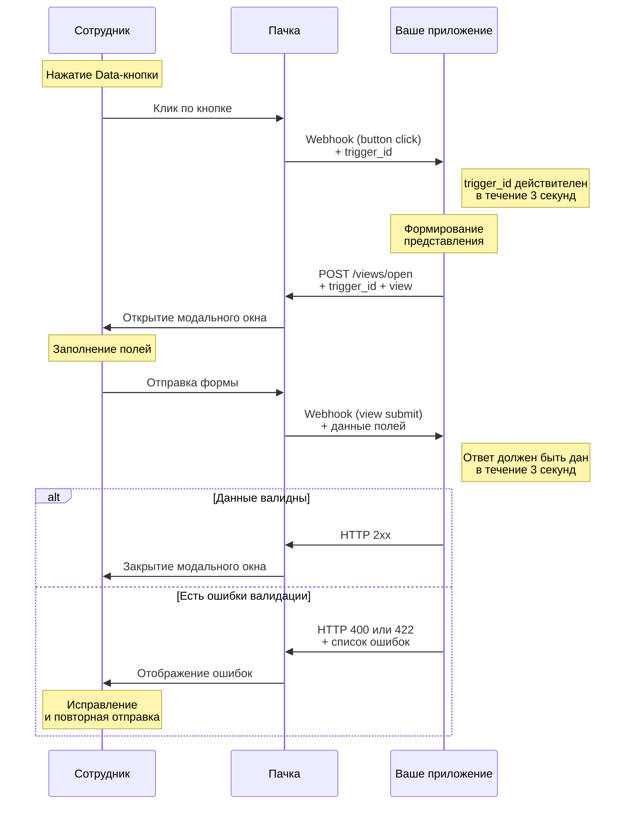

> Расположение: Формы
> Краткое содержание: Модальные формы ботов в Пачке: поля ввода, списки, даты, время и файлы, жизненный цикл представления от нажатия кнопки до валидации и закрытия окна, что нужно боту и куда писать результат
> Это Markdown-версия конкретной страницы. Для контекста за её пределами (правила API, полный перечень методов, авторизация) ОБЯЗАТЕЛЬНО открой [llms.txt](https://dev.pachca.com/llms.txt) перед ответом — это сэкономит токены и предотвратит неполный ответ.


# Формы

Форма в Пачке — модальное окно с полями, которые задаёт бот. В API форму называют представлением (`view`). Сотрудник заполняет и отправляет форму, а результат приходит на сервер бота.

**Сделать с агентом.** Агент создаст бота с формой под вашу задачу, напишет обработчик и проверит в беседе ошибки под полями и ответ бота. Вставьте промпт в чат с ИИ-агентом, к которому [подключена Пачка](/guides/mcp/connect). Агенту, который уже выполняет этот промпт: ниже его копия, начинать заново не нужно.

```text
Создай бота с формой под мою задачу. Скачай страницы документации и делай по ним: `curl -sL https://dev.pachca.com/guides/forms/overview.md https://dev.pachca.com/guides/forms/handling.md https://dev.pachca.com/guides/forms/blocks.md https://dev.pachca.com/guides/bots/interactive.md`. Инструмент для веба отдаёт пересказ, бери его, только если curl не сработал. Если страницы не открылись и так или у тебя нет инструментов Пачки, остановись и скажи.

1. Спроси, как назвать бота, какой командой вызывать форму, какие в ней поля и проверки, что бот ответит после отправки и на чём писать: TypeScript или Python.
2. Создай бота с моей командой по разделам «Что настроить» и «Без публичного адреса» и беседу для проверки с ботом.
3. В этой папке напиши обработчик с формой по разделу «Код бота», проверки полей по разделу «Закрытие и отображение ошибок». Токен и Signing secret держи только в `.env`, добавленном в `.gitignore`.
4. Запусти в фоне обработчик и пересылку событий. Попроси меня отправить форму сначала с ошибкой, потом верно, и проверь ответ бота.
5. Перечисли, что создано, как всё перезапустить и убрать.

Если мешают права, роль или настройки пространства, не обходи: скажи, что мешает и кто это изменит. Чего не можешь сам, дай мне готовыми командами.
```


> Форма открывается по нажатию Data-кнопки в сообщении бота.


## Модальное окно

Модальное окно состоит из заголовка, кнопки закрытия, полей и кнопки отправки. Поля задают [блоки представления](/guides/forms/blocks): подзаголовки, текст, разделители, поля ввода, списки, радиокнопки, чекбоксы, дата, время и загрузка файлов.


*Модальное окно*


## Жизненный цикл модального окна

1. Сотрудник нажимает Data-кнопку в сообщении бота, и бот получает исходящий вебхук с уникальным `trigger_id`
2. Бот [открывает представление](/guides/forms/handling#otkrytie-predstavleniya) с этим `trigger_id`, и сотрудник видит модальное окно
3. Сотрудник заполняет поля и отправляет форму, а бот [получает вебхук](/guides/forms/handling#poluchenie-rezultatov) с их значениями
4. Бот отвечает на вебхук: кодом `2xx` [закрывает окно](/guides/forms/handling#zakrytie-predstavleniya), а кодом `400` или `422` со [списком ошибок](/guides/forms/handling#otobrazhenie-oshibok) показывает их под полями
5. Результат бот по желанию пишет в чат, где нажали кнопку: [по `chat_id` из вебхука](/guides/forms/handling#otvet-v-chat)

Нажатия и отправленные формы доходят до бота, когда у него задан адрес исходящего вебхука или включена история событий. Если адреса нет, а история включена, бот забирает их из истории событий, и ответить на отправку формы нужно [отдельным методом](/guides/forms/handling#otvet-cherez-istoriyu-sobytiy).

**Жизненный цикл модального окна**




## Что нужно боту

- **Событие о нажатиях.** На вкладке **Исходящий вебхук** включите **Нажатие кнопок**: с ним приходят и нажатия, и отправленные формы.
- **Права токена.** Открыть форму позволяет право `views:write`, а изменить сообщение с кнопкой — `messages:update`. Оба входят в набор интерактивного бота, подробнее в разделе [Наборы прав под типовые задачи](/guides/permissions#nabory-prav-pod-tipovye-zadachi).
- **Быстрый ответ.** `trigger_id` действует 3 секунды, и на отправку формы тоже нужно ответить за 3 секунды. Все сроки — в разделе [Сроки ответа](/guides/webhook/handler#sroki-otveta).

Бот целиком, от команды до формы и результата в чате, собран в разделе [Интерактивный бот](/guides/bots/interactive).


## Связанные разделы

- [Блоки представления](/guides/forms/blocks)
- [Обработка форм](/guides/forms/handling)
- [Кнопки в сообщениях](/guides/buttons)
- [Исходящие вебхуки](/guides/webhook/overview)
